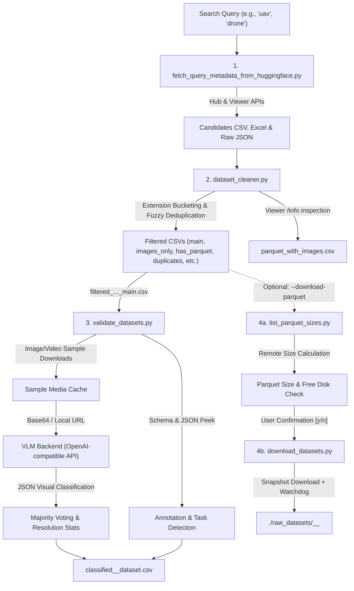

# Hugging Face Dataset Survey & Multimodal Validation Pipeline

An automated, end-to-end research survey and validation pipeline designed to discover, filter, deduplicate, visually inspect (via Vision-Language Models), analyze annotations for, and selectively download computer vision and multimodal datasets from the **Hugging Face Hub**.

---

## 📑 Table of Contents

- [Overview](#overview)
- [System Architecture & Workflow](#system-architecture--workflow)
- [Key Features](#key-features)
- [Project Structure](#project-structure)
- [Prerequisites & Installation](#prerequisites--installation)
- [VLM Server Setup](#vlm-server-setup)
- [Quick Start](#quick-start)
- [Detailed Pipeline Stages & Script Reference](#detailed-pipeline-stages--script-reference)
  - [1. Master Orchestrator (`Survey_script.py`)](#1-master-orchestrator-survey_scriptpy)
  - [2. Metadata Harvester (`fetch_query_metadata_from_huggingface.py`)](#2-metadata-harvester-fetch_query_metadata_from_huggingfacepy)
  - [3. Dataset Cleaner & Deduplicator (`dataset_cleaner.py`)](#3-dataset-cleaner--deduplicator-dataset_cleanerpy)
  - [4. Multimodal VLM Classifier & Annotation Validator (`validate_datasets.py`)](#4-multimodal-vlm-classifier--annotation-validator-validate_datasetspy)
  - [5. Parquet Storage Inspector (`list_parquet_sizes.py`)](#5-parquet-storage-inspector-list_parquet_sizespy)
  - [6. Robust Dataset Downloader (`download_datasets.py`)](#6-robust-dataset-downloader-download_datasetspy)
- [Output Artifacts & Data Dictionary](#output-artifacts--data-dictionary)
- [Resumability & Crash Tolerance](#resumability--crash-tolerance)
- [Advanced Usage & Passthrough Options](#advanced-usage--passthrough-options)
- [Troubleshooting & FAQs](#troubleshooting--faqs)

---

## Overview

Conducting systematic surveys across thousands of datasets on Hugging Face often suffers from noisy search results, duplicate repositories, unstandardized formats, missing media schema information, and ambiguous visual content.

This pipeline solves these challenges by providing a four-stage automated workflow:
1. **Metadata Ingestion**: Querying the HF Hub API and Dataset Viewer API to extract repository metadata, download metrics, configurations, and splits.
2. **Deterministic Triage & Deduplication**: Categorizing datasets by media extensions (images, videos, parquet, zip archives), detecting duplicate datasets using fuzzy string matching and popularity ranking, and checking parquet schema image columns without downloading dataset contents.
3. **Multimodal VLM Classification & Heuristic Validation**: Sampling images or video clips from each candidate dataset and prompting a local/remote Vision-Language Model (e.g., Qwen2.5-VL / Qwen3-VL via OpenAI-compatible endpoints) with structured JSON schemas. Aggregates results via majority voting, extracts resolution metrics, identifies licenses, and inspects files/schemas for annotation evidence (object detection, semantic segmentation, classification).
4. **Pre-flight Sizing & Controlled Download**: Computing exact remote Parquet file sizes, comparing against available local storage, and downloading dataset repositories with snapshot watchdog timeouts.

---

## System Architecture & Workflow



---

## Key Features

- **End-to-End Orchestration**: A single command (`Survey_script.py`) drives the entire multi-stage survey.
- **Zero-Download Remote Schema Inspection**: Queries the Hugging Face Dataset Viewer API to check feature definitions (`_type: Image` or `bytes`/`path` objects) without downloading gigabytes of parquet files.
- **Intelligent Deduplication**: Uses `difflib.SequenceMatcher` over normalized dataset descriptions and names to cluster re-uploads and forks, designating canonical datasets by highest community engagement (`downloads + likes`) and creation date.
- **Dual-Backend VLM Support**: Route image inference to local Apple Silicon servers (e.g., MLX / LM Studio / Ollama) via base64 payloads while routing heavy video clips to high-throughput vLLM instances on Linux via direct media paths.
- **Ensemble-Style Majority Voting**: Samples up to $N$ random media instances per dataset, querying the VLM on each and computing consensus metrics (majority verdict, vote count, sample total).
- **Heuristic Annotation Detection**: Inspects dataset features, repository file patterns (`coco`, `instances_*.json`, `classes.txt`, `labelme`), and reads the first ~2MB of candidate JSONs to identify object detection, segmentation masks, or classification classes.
- **Disk Safety Gate**: Checks total remote Parquet sizes against local disk free space and prompts for confirmation before initiating downloads.
- **Fully Resumable & Stream-Logged**: Every script appends results incrementally and checks existing outputs to resume without data loss. Live output is logged to timestamped run directories in `./logs/`.

---

## Project Structure

```text
Final_Pipeline/
├── Survey_script.py                          # Master entrypoint orchestrating stages 1-4
├── fetch_query_metadata_from_huggingface.py   # Stage 1: HF Hub query & metadata harvester
├── dataset_cleaner.py                        # Stage 2: Media classification, deduplication & split
├── validate_datasets.py                      # Stage 3: VLM visual classification & annotation detection
├── list_parquet_sizes.py                     # Stage 4a: Remote parquet size calculation
├── download_datasets.py                      # Stage 4b: Resumable repo snapshot downloader
│
├── logs/                                     # Auto-generated run logs
│   └── <query>_<timestamp>/                  # Per-run logs (01_fetch.log, 02_clean.log, etc.)
│
├── hf_<query>_candidates/                    # Auto-generated dataset candidate directory
│   ├── hf_<query>_candidates.csv             # Full metadata catalog
│   ├── hf_<query>_candidates.xlsx            # Multi-sheet Excel workbook
│   ├── hf_<query>_raw.json                   # Raw JSON API dump
│   ├── filtered_hf_<query>_candidates_main.csv
│   ├── filtered_hf_<query>_candidates_has_parquet.csv
│   ├── filtered_hf_<query>_candidates_images_only.csv
│   ├── filtered_hf_<query>_candidates_mixed_media.csv
│   ├── filtered_hf_<query>_candidates_needs_review.csv
│   ├── filtered_hf_<query>_candidates_excluded.csv
│   ├── filtered_hf_<query>_candidates_duplicates.csv
│   ├── filtered_hf_<query>_candidates_parquet_with_images.csv
│   └── parquet_sizes/                        # Detail and summary size CSVs
│
├── classified_<query>_dataset.csv            # Final VLM classification & annotation results
└── raw_datasets/                             # (Optional) Downloaded snapshot repositories
```

---

## Prerequisites & Installation

### 1. Python Environment

Python 3.10+ is recommended. Install required Python packages:

```bash
pip install requests pandas tqdm openpyxl huggingface_hub pillow
```

### 2. System Dependencies

Video validation and metadata extraction rely on `ffmpeg` and `ffprobe` for computing duration, dimensions, and trimming clips:

- **macOS (Homebrew)**:
  ```bash
  brew install ffmpeg
  ```
- **Ubuntu/Debian**:
  ```bash
  sudo apt-get update && sudo apt-get install -y ffmpeg
  ```

### 3. Hugging Face Authentication (Optional but Highly Recommended)

An unauthenticated HF API client is limited to 500 requests per 300 seconds. Setting a token raises this limit and grants access to gated/licensed datasets:

```bash
# Linux / macOS
export HF_TOKEN="hf_xxxxxxxxxxxxxxxxxxxxxxxxxxxxxxxxx"

# Windows (PowerShell)
$env:HF_TOKEN="hf_xxxxxxxxxxxxxxxxxxxxxxxxxxxxxxxxx"
```

---

## VLM Server Setup

`validate_datasets.py` communicates with any **OpenAI-compatible Vision-Language Model API** exposing `/v1/chat/completions`.

### Example 1: Local LM Studio / MLX on macOS
1. Load a vision model such as `Qwen/Qwen2.5-VL-7B-Instruct` or `Qwen3-VL-8B-Instruct-MLX-4bit`.
2. Start the local server (default: `http://127.0.0.1:8000/v1` or `http://127.0.0.1:1234/v1`).

### Example 2: vLLM Server on Linux (Ideal for Video)
Start vLLM with multi-modal support enabled:

```bash
vllm serve Qwen/Qwen2.5-VL-7B-Instruct \
    --port 8000 \
    --trust-remote-code \
    --limit-mm-per-prompt 'video=1,image=1' \
    --max-model-len 16384 \
    --allowed-local-media-path /path/to/Final_Pipeline
```

---

## Quick Start

### Run the Full Pipeline

Run the master survey script for a search term (e.g. `uav`) with VLM classification:

```bash
python Survey_script.py uav \
    --vlm-base-url http://127.0.0.1:8000/v1 \
    --vlm-model Qwen/Qwen2.5-VL-7B-Instruct \
    --download-parquet
```

### Run Survey Without VLM (Metadata & Cleaning Only)

```bash
python Survey_script.py drone --skip-validate
```

### Run Fully Non-Interactive (Auto-confirm downloads)

```bash
python Survey_script.py uav \
    --vlm-base-url http://127.0.0.1:8000/v1 \
    --vlm-model Qwen/Qwen2.5-VL-7B-Instruct \
    --download-parquet \
    --assume-yes
```

---

## Detailed Pipeline Stages & Script Reference

### 1. Master Orchestrator (`Survey_script.py`)

The main entrypoint coordinating all stages sequentially, streaming logs live to stdout and writing structured logs to `logs/<slug>_<timestamp>/`.

#### CLI Options:
| Flag | Description | Default |
| :--- | :--- | :--- |
| `query` | Positional query keyword (e.g. `uav`, `drone`, `aerial`). | *Required* |
| `--sort` | Sorting strategy passed to stage 1 (`trendingScore`, `downloads`, `likes`). | `trendingScore` |
| `--fetch-limit` | Maximum dataset metadata records to fetch. | `None` (All) |
| `--vlm-base-url` | Base URL for OpenAI-compatible VLM server. | `None` (*Req. unless skip*) |
| `--vlm-model` | Target model identifier. | `None` (*Req. unless skip*) |
| `--vlm-api-key` | Optional API key for VLM server. | `None` |
| `--skip-validate` | Skip stage 3 (VLM classification). | `False` |
| `--download-parquet`| Check sizes and download parquet datasets after stage 3. | `False` |
| `--download-dir` | Directory to save downloaded dataset repositories. | `./raw_datasets` |
| `--assume-yes` | Auto-confirm disk usage prompt. | `False` |
| `--fetch-tags` | Raw string of CLI arguments passed to fetch stage. | `""` |
| `--clean-tags` | Raw string of CLI arguments passed to clean stage. | `""` |
| `--classify-tags` | Raw string of CLI arguments passed to validate stage. | `""` |
| `--download-tags` | Raw string of CLI arguments passed to download stage. | `""` |

---

### 2. Metadata Harvester (`fetch_query_metadata_from_huggingface.py`)

Fetches candidate repositories matching the query via the Hugging Face Hub API with pagination (`PAGE_SIZE=30`). Enriches records with Dataset Viewer endpoints (`/is-valid`, `/splits`, `/size`).

#### Standalone Execution:
```bash
python fetch_query_metadata_from_huggingface.py uav --sort trendingScore --output-dir hf_uav_candidates
```

#### Generated Files:
- `hf_<query>_candidates.csv`: Complete metadata table with 30+ columns.
- `hf_<query>_candidates.xlsx`: Multi-tab workbook containing *Candidates*, *Extraction Metadata*, and *Repository Files* catalog.
- `hf_<query>_raw.json`: Complete raw API response records.

---

### 3. Dataset Cleaner & Deduplicator (`dataset_cleaner.py`)

Classifies repository contents by file extensions, handles fuzzy deduplication, and splits datasets into targeted review CSVs.

#### Extension Buckets:
- **Image**: `.jpg`, `.jpeg`, `.png`, `.webp`, `.bmp`, `.tif`, `.tiff`, `.gif`
- **Video**: `.mp4`, `.avi`, `.mov`, `.mkv`, `.webm`, `.wmv`, `.m4v`, `.flv`, `.mpeg`, `.mpg`
- **Parquet**: `.parquet`
- **Zip / Archive**: `.zip`, `.tar`, `.gz`, `.tgz`, `.7z`, `.rar`
- **Audio / Other**: `.mp3`, `.wav`, etc.

#### Stage Breakdown:
1. **Stage 1 - Ingestion**: Repositories are bucketed into `included` (has image, video, or parquet), `needs_review` (only zip archives), or `excluded` (unsupported formats, empty, or 404/gated).
2. **Stage 2 - Deduplication**: Normalizes descriptions and names. Pairs with description similarity $\ge 0.90$ or name similarity $\ge 0.85$ (with matching file types) are grouped. The entry with the highest `downloads + likes` and earliest creation date is designated as `canonical`; others are marked `duplicate`.
3. **Stage 3 - Sub-bucketing**: `canonical` rows are separated into `images_only`, `has_parquet`, and `mixed_media`.
4. **Stage 4 - Zero-Download Schema Inspection**: For `has_parquet` records, queries the HF Dataset Viewer `/info` endpoint (5s timeout) to detect image feature columns without downloading data.

#### Standalone Execution:
```bash
python dataset_cleaner.py \
    --input hf_uav_candidates/hf_uav_candidates.csv \
    --desc-sim-threshold 0.90 \
    --name-sim-threshold 0.85
```

---

### 4. Multimodal VLM Classifier & Annotation Validator (`validate_datasets.py`)

Samples media from each dataset and performs deep visual classification and annotation heuristic extraction.

#### Visual Classification Schema:
The VLM is prompted to return strict JSON covering:
- `image_description`: Concise one-sentence visual summary.
- `from_drone_or_of_drone`:
  - **Of drone**: Drone(s) are visible as subjects in the frame.
  - **From drone**: Elevated/aerial viewpoint looking down/out; no drone visible.
  - **Unclear**: Ambiguous perspective.
- `closeup_or_distant`: `closeup`, `distant`, or `NA`.
- `non_drone_flying_objects`: `Yes` (planes, birds, helicopters), `No`, or `Not specified / NA`.
- `day_or_night`: `Day`, `Night`, `Dusk/Dawn`, or `Unclear`.
- `visual_or_infrared`: `Visual` (RGB/photo) vs. `Infrared` (thermal/heat signature).
- `drone_type`: `Fixed wing`, `Rotary` (quadcopter/multirotor), or `NA`.

#### Majority Voting:
Samples $N$ media files per dataset (default: 100), executes multithreaded VLM calls, downscales images to $\le 1024\text{px}$ for latency reduction, and computes majority consensus:
$$\text{Majority Ratio} = \frac{\text{Count of Majority Response}}{\text{Total Valid Responses}}$$

#### Annotation & Task Detection:
- Heuristically scans repository files for patterns (`instances_*.json`, `coco`, `classes.txt`, `labelme`, `yolo`, `seg_map`, etc.).
- Safely streams up to 2MB of candidate JSON files to check for bounding box keys (`bbox`, `annotations`, `categories`, `segmentation`).
- Generates boolean flags: `Is Annotation?`, `Is Classification?`, `Is Segmentation?`, and detailed `Annotation evidence`.

#### Standalone Execution:
```bash
python validate_datasets.py \
    --input hf_uav_candidates/filtered_hf_uav_candidates_main.csv \
    --output classified_uav_dataset.csv \
    --vlm-base-url http://127.0.0.1:8000/v1 \
    --vlm-model Qwen/Qwen2.5-VL-7B-Instruct \
    --n-images 50
```

---

### 5. Parquet Storage Inspector (`list_parquet_sizes.py`)

Inspects remote Parquet files using `HfApi.get_paths_info()` without downloading content.

#### Features:
- Watchdog timeout per dataset (`--timeout 25.0s`) to prevent API stalls.
- Robust HTTP 429 backoff handling (`Retry-After` header extraction).
- Outputs two CSVs:
  - `*_parquet_files.csv`: Individual file names and byte/MB sizes.
  - `*_parquet_summary.csv`: Aggregated parquet count and total MB per dataset.

#### Standalone Execution:
```bash
python list_parquet_sizes.py \
    hf_uav_candidates/filtered_hf_uav_candidates_has_parquet.csv \
    --detail-out hf_uav_candidates/parquet_sizes/uav_parquet_files.csv \
    --summary-out hf_uav_candidates/parquet_sizes/uav_parquet_summary.csv
```

---

### 6. Robust Dataset Downloader (`download_datasets.py`)

Downloads entire repository snapshots into structured subdirectories (`./raw_datasets/<org>__<dataset_name>`).

#### Features:
- Built on `huggingface_hub.snapshot_download`.
- Thread watchdog with configurable timeout (`--timeout 300s`) to abandon stalled socket transfers.
- Safe resumption using local `.download_complete` marker files.
- Supports filtering by status columns.

#### Standalone Execution:
```bash
python download_datasets.py \
    --input hf_uav_candidates/filtered_hf_uav_candidates_has_parquet.csv \
    --out-dir ./raw_datasets \
    --id-column "Dataset ID" \
    --timeout 600
```

---

## Output Artifacts & Data Dictionary

### Final Classification CSV (`classified_<query>_dataset.csv`)

| Column Name | Description | Example Values |
| :--- | :--- | :--- |
| `dataset_id` | Hugging Face repository identifier | `org/uav-detection-v1` |
| `Image / Video` | Predominant media modality sampled | `Image`, `Video`, `No media found` |
| `From drone / Of drone` | Majority visual perspective | `From drone`, `Of drone`, `Unclear` |
| `From drone / Of drone - count` | Votes for the winning perspective | `48` |
| `From drone / Of drone - total` | Total valid VLM samples evaluated | `50` |
| `Within dataset - do you have more closeups or more distant shots (of drones)` | Shot distance classification | `distant`, `closeup`, `NA` |
| `Does dataset also have non-drone flying objects (planes/birds)` | Presence of other aerial objects | `Yes`, `No`, `Not specified / NA` |
| `Day or night` | Environmental lighting condition | `Day`, `Night`, `Dusk/Dawn` |
| `Visual or Infra red images` | Sensor modality | `Visual`, `Infrared`, `Unclear` |
| `Type of drone (fixed wing / rotary)` | Identified aircraft category | `Rotary`, `Fixed wing`, `NA` |
| `Resolution of images (majority)` | Most frequent pixel resolution | `1920x1080 (42/50 samples)` |
| `Availability and licensing (free/which license)` | Extracted license from metadata/card | `apache-2.0`, `cc-by-4.0`, `Unspecified` |
| `How recently updated?` | Last modification timestamp | `2024-08-15` |
| `Is Annotation?` | Heuristic detection of labels/annotations | `Yes`, `No`, `Uncertain` |
| `Is Classification?` | Heuristic detection of class lists | `Yes`, `No` |
| `Is Segmentation?` | Heuristic detection of segmentation masks | `Yes`, `No` |
| `Annotation evidence` | Contextual evidence string | `Found annotations.json with categories; Feature 'mask'` |

---

## Resumability & Crash Tolerance

Every stage in this pipeline is built to be resilient against network interruptions, API rate limits, and server crashes:

1. **Incremental CSV Appending**: Outputs are flushed to disk row-by-row with file synchronization.
2. **Automatic Skip Checkpoints**: When re-running a script against an existing output directory, processed `dataset_id`s are loaded into memory and skipped automatically.
3. **Download Markers**: Repositories successfully downloaded are tagged with `.download_complete`. Re-running `download_datasets.py` instantly bypasses finished folders.
4. **Clean Restart Mode**: To discard partial caches and start from scratch, pass `--restart` to worker scripts.

---

## Advanced Usage & Passthrough Options

The master script `Survey_script.py` allows passing custom flags directly to downstream worker scripts using passthrough tags:

```bash
python Survey_script.py drone \
    --vlm-base-url http://127.0.0.1:8000/v1 \
    --vlm-model Qwen/Qwen2.5-VL-7B-Instruct \
    --fetch-tags "--limit 50 --sort downloads" \
    --clean-tags "--desc-sim-threshold 0.85" \
    --classify-tags "--n-images 20 --video-window-seconds 15" \
    --download-parquet \
    --download-tags "--timeout 600"
```

---

## Troubleshooting & FAQs

### 1. `HTTP 429 Rate Limit Exceeded`
- **Cause**: Too many requests to the Hugging Face Hub API within a short window.
- **Fix**: Set your `HF_TOKEN` environment variable. The scripts automatically back off and sleep according to `Retry-After` response headers.

### 2. `ConnectionRefusedError` during VLM validation
- **Cause**: The VLM endpoint specified in `--vlm-base-url` is unreachable or not started.
- **Fix**: Test your server with curl:
  ```bash
  curl http://127.0.0.1:8000/v1/models
  ```
  Ensure `--vlm-base-url` includes `/v1` if using standard OpenAI-compatible endpoints.

### 3. `ffmpeg` or `ffprobe` not found
- **Cause**: Video processing dependencies are missing from system `$PATH`.
- **Fix**: Install ffmpeg via your package manager (`brew install ffmpeg` or `sudo apt install ffmpeg`).

### 4. VLM Context Length / Token Overflow on Video
- **Cause**: Video duration is generating too many visual tokens for the model's context window.
- **Fix**: Lower the sample duration via `--classify-tags "--video-window-seconds 10"` or increase the server's `--max-model-len`.

---

## License

This project is licensed under the [Apache-2.0 License](LICENSE).
